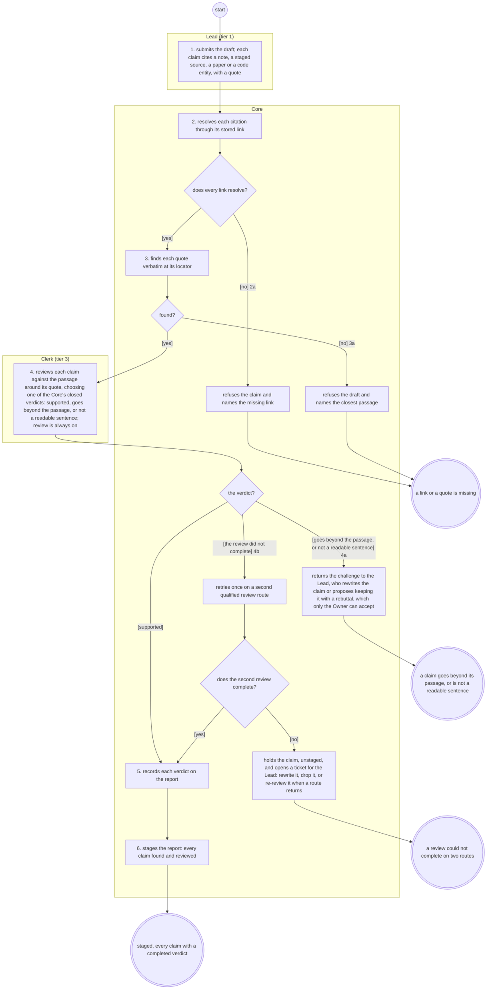

<!-- generated by render_pack.py from verify-claims.spec.yaml sha256=9b95337bf47241a0ce087eb838789c7468418a3173ed0aa0ed6a06aaa8d24f37; edit the spec, not this file -->
# Verify a report's claims (proposed)

**UC3 · to-be · `PROPOSED_UNACCEPTED`** · spec [verify-claims.spec.yaml](../verify-claims.spec.yaml)

| Problem | |
|---|---|
| symptom | As-is: review off by default; an incomplete review staged the claim unchecked. |
| root | Review is part of verification, and a claim is staged only with a completed verdict. |

## Written use case

| Field | Content |
|---|---|
| **Use case name** | Verify a report's claims |
| **Brief description** | Every claim resolved through its stored link, found verbatim, and reviewed; an incomplete review holds the claim. |
| **Primary actor** | Core |
| **Supporting actors** | Clerk, Lead |
| **Preconditions** | A drafted report |
| **Trigger** | The draft is submitted |
| **Success guarantee** | Every staged claim has a completed verdict |
| **Minimal guarantee** | Nothing is staged unchecked |
| **Open questions** | OP9: why reviews of full-PDF quotes failed |

**Main success scenario** (generated: the guard-true path, in step order)

1. The Lead (tier 1) submits the draft; each claim cites a note, a staged source, a paper or a code entity, with a quote.
2. The Core resolves each citation through its stored link.
3. The Core finds each quote verbatim at its locator.
4. The Clerk (tier 3) reviews each claim against the passage around its quote, choosing one of the Core's closed verdicts: supported, goes beyond the passage, or not a readable sentence; review is always on.
5. The Core records each verdict on the report.
6. The Core stages the report: every claim found and reviewed.

**Extensions** (generated: one per non-happy guard; numbered by the step it leaves)

- **2a** (from: does every link resolve?) *anticipated*
  - `2a1` No.
  - `2a2` The Core refuses the claim and names the missing link.
  - `2a3` The use case ends: a link or a quote is missing.
- **3a** (from: found?) *anticipated*
  - `3a1` No.
  - `3a2` The Core refuses the draft and names the closest passage.
  - `3a3` The use case ends: a link or a quote is missing.
- **4a** (from: the verdict?) *anticipated*
  - `4a1` Goes beyond the passage, or not a readable sentence.
  - `4a2` The Core returns the challenge to the Lead, who rewrites the claim or proposes keeping it with a rebuttal, which only the Owner can accept.
  - `4a3` The use case ends: a claim goes beyond its passage, or is not a readable sentence.
- **4b** (from: the verdict?) *anticipated*
  - `4b1` The review did not complete.
  - `4b2` The Core retries once on a second qualified review route.
  - `4b3` The Core decides: does the second review complete?
  - `4b3a` If no: holds the claim, unstaged, and opens a ticket for the Lead: rewrite it, drop it, or re-review it when a route returns.
  - `4b4` If yes:
  - `4b5` Rejoin at 5.

## Activity diagram



## Lane load

| Lane | On the main success scenario | Anywhere in the diagram |
|---|---|---|
| Lead (tier 1) | 1 | 1 |
| Core | 7 | 13 |
| Clerk (tier 3) | 1 | 1 |

Paths by how they end: **challenged** 1, **held** 1, **refused** 2, **success** 1.

## Decision tree

```text
start: Verify a report's claims (proposed)
      └─ T1: yes / yes / supported  ⇒ staged, every claim with a completed verdict
  └─ T2: no  ⇒ a link or a quote is missing
    └─ T3: yes / no  ⇒ a link or a quote is missing
      └─ T4: yes / yes / goes beyond the passage, or not a readable sentence  ⇒ a claim goes beyond its passage, or is not a readable sentence
        └─ T5: yes / yes / the review did not complete / no  ⇒ a review could not complete on two routes
        └─ T6: yes / yes / the review did not complete / yes  ⇒ rejoins at step 5
```

## Test cases

One test per path: the main success scenario, then each extension.

| Test | Path (guards taken) | Extension | Expected outcome |
|---|---|---|---|
| T1 | does every link resolve? → yes; found? → yes; the verdict? → supported | MSS | staged, every claim with a completed verdict |
| T2 | does every link resolve? → no | 2a | a link or a quote is missing |
| T3 | does every link resolve? → yes; found? → no | 3a | a link or a quote is missing |
| T4 | does every link resolve? → yes; found? → yes; the verdict? → goes beyond the passage, or not a readable sentence | 4a | a claim goes beyond its passage, or is not a readable sentence |
| T5 | does every link resolve? → yes; found? → yes; the verdict? → the review did not complete; does the second review complete? → no | 4b | a review could not complete on two routes |
| T6 | does every link resolve? → yes; found? → yes; the verdict? → the review did not complete; does the second review complete? → yes | 4b | rejoins at step 5 |

### Boundary values

_None declared._

## As-is weaknesses this handles

| As-is weakness | Where here | How it is handled |
|---|---|---|
| W-VER-01 (verify-claims): Claim review is off by default, so a garbled claim was staged checked only for its quote (OP7). | review | Review is always on. |
| W-VER-02 (verify-claims): A review that does not complete marks the claim unchecked and stages it anyway; three full-PDF quotes went this way (OP9). | retry | An incomplete review is retried on a second route; if that fails too, the claim is held, never staged unchecked. |

## Evidence

- AS-IS-FINDINGS.md T3 and T8; as-is verify-claims extensions 3a and 4b.

## Checks

Errors: none

Warnings: none
