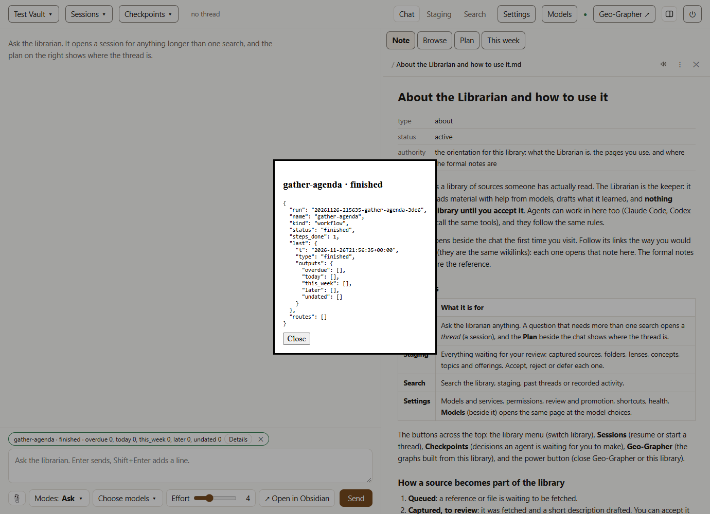
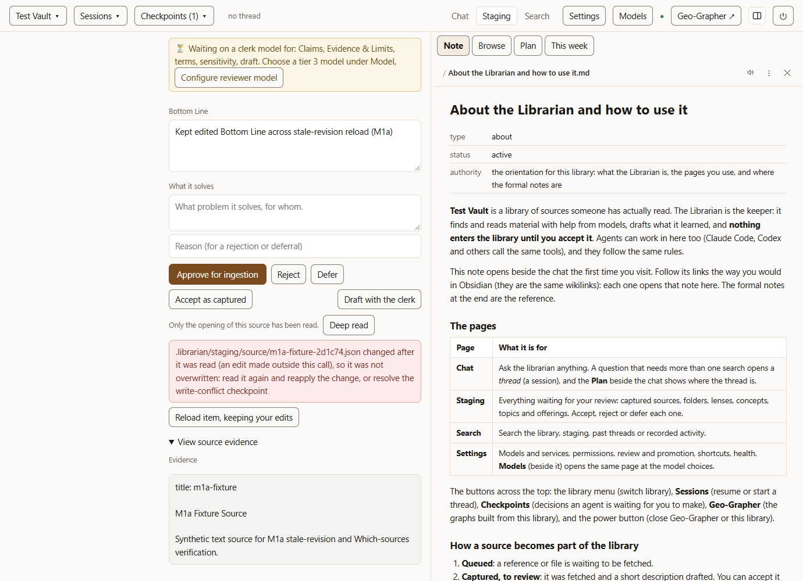
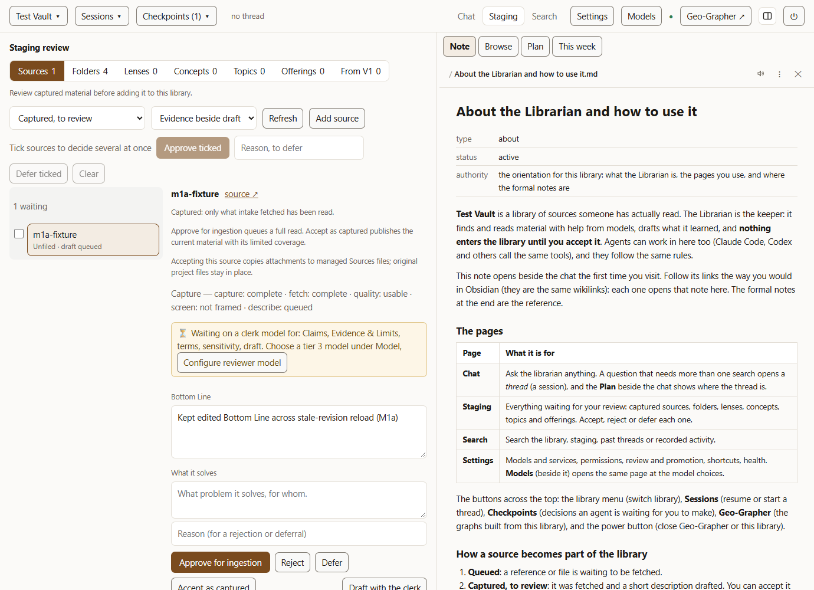
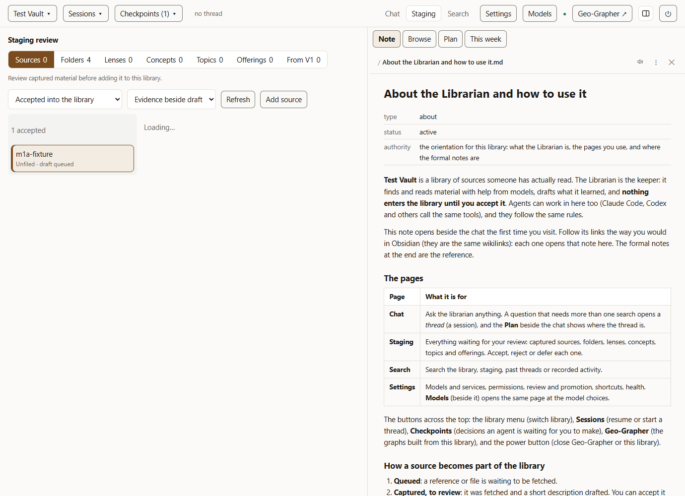
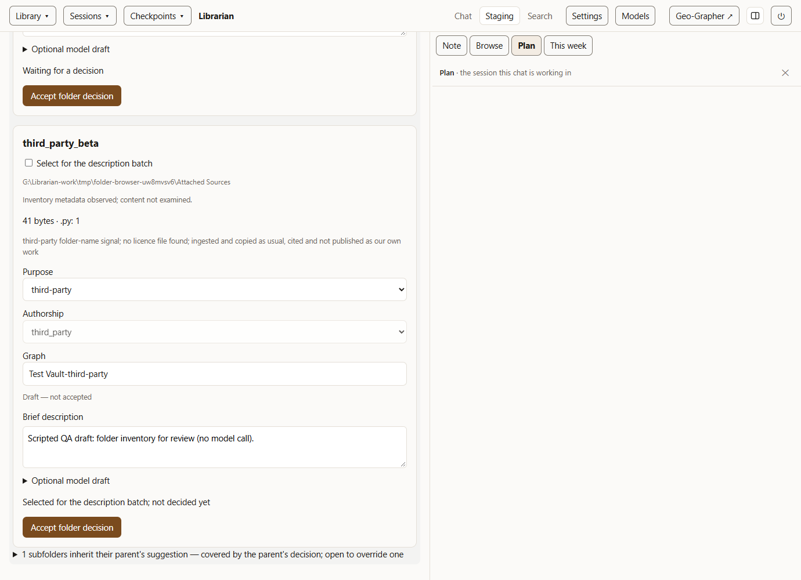
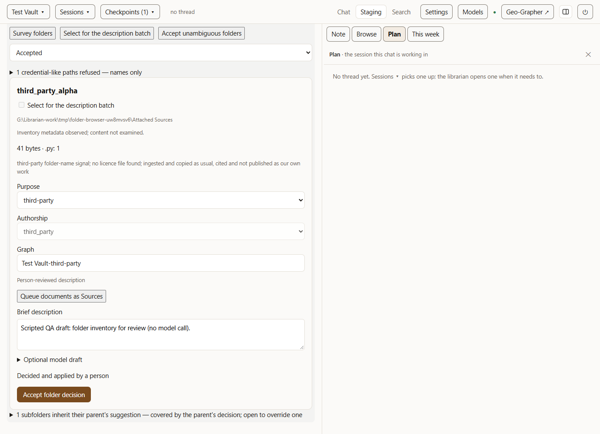

# M1a Web UI Browser Check (26 November 2026)

- **Brief:** [2026-11-26-delegation-briefs.md §4](../2026-11-26-delegation-briefs.md)
- **Branch:** `antigravity/delegated-2026-11-26` (base `b583f03`, M1a Web UI code untouched)
- **Scripts:** [`ui/folders-smoke.mjs`](../../ui/folders-smoke.mjs), [`ui/m1a-smoke.mjs`](../../ui/m1a-smoke.mjs)

## Command and environment

Each smoke script was run against its own fresh disposable Core instance started by [`tests/folder_review_demo.py`](../../tests/folder_review_demo.py) with temporary directories on `G:` (to keep `C:` above Geo-Grapher's 5 GiB reserve) and zero model/API keys configured:

```powershell
$env:TMP="G:\Librarian-work\tmp"; $env:TEMP=$env:TMP
$env:WAVE_L_WHEEL_PYTHON="G:/Libraries/_geo-runtime/env/Scripts/python.exe"
$env:PYTHONPATH="G:\Librarian-work\librarian-delegated\src"
```

1. **Existing folder smoke (`ui/folders-smoke.mjs`):** updated to allow disposable fixture sources under `G:\Librarian-work\tmp` alongside `G:\Libraries\_qa`, and to await the re-rendered waiting view and expand collapsed `details.lib-inherited-folders` before interacting with the `src` subfolder card.
   - Output: `PASS: visible draft, metadata, suggested group, person acceptance, persistence, stale refusal and re-survey; zero models`
2. **M1a UI smoke (`ui/m1a-smoke.mjs`):** verifies all four M1a Web UI requirements with zero `pageerror` events and zero unexpected console errors:
   - `✓ M1a Check 1: finished run chip Details button opens run_status record`
   - `✓ M1a Check 2: Reload item, keeping your edits preserves Bottom Line`
   - `✓ M1a Check 3: Which sources lists processing and accepted items`
   - `✓ M1a Check 4: folder cards show distinct batch-selected and person-decided labels`
   - Output: `PASS: all 4 M1a browser checks verified against live demo Core; zero models`

## Checks and screenshots

### 1. Finished run chip `Details` opens `run_status` record
Started zero-model workflow `gather-agenda` via `/api/actions`, waited for `.lib-chip.lib-action-finished`, clicked `Details of gather-agenda`, and verified the `<dialog>` heading (`gather-agenda · finished`) and JSON `run_status` body (`"status": "finished"`):



### 2. Stale-revision `"Reload item, keeping your edits"` keeps the Bottom Line
Uploaded & ingested `m1a-fixture.txt`, edited `Bottom Line` (`#lib-bl`) to `"Kept edited Bottom Line across stale-revision reload (M1a)"`, bumped the item's `staged_revision` externally via `staging_flag`, and clicked `Accept as captured`. Verified the conflict notice and `"Reload item, keeping your edits"` button rendered, clicked reload, and asserted `#lib-bl` kept the edited Bottom Line across reload:





### 3. `"Which sources"` lists `processing` and `accepted` items
Verified the `"Which sources"` `<select>` includes `<option value="processing">Being ingested</option>` and `<option value="accepted">Accepted into the library</option>`, exercised `processing`, accepted `m1a-fixture`, and confirmed it lists under `accepted`:



### 4. Folder cards distinguish batch-selected from person-decided state
Checked `third_party_beta`, clicked `Select for the description batch`, reloaded the page to read persisted Core state, and confirmed `third_party_beta` renders `"Selected for the description batch; not decided yet"` while `third_party_alpha` after acceptance renders `"Decided and applied by a person"` under `Accepted`:




